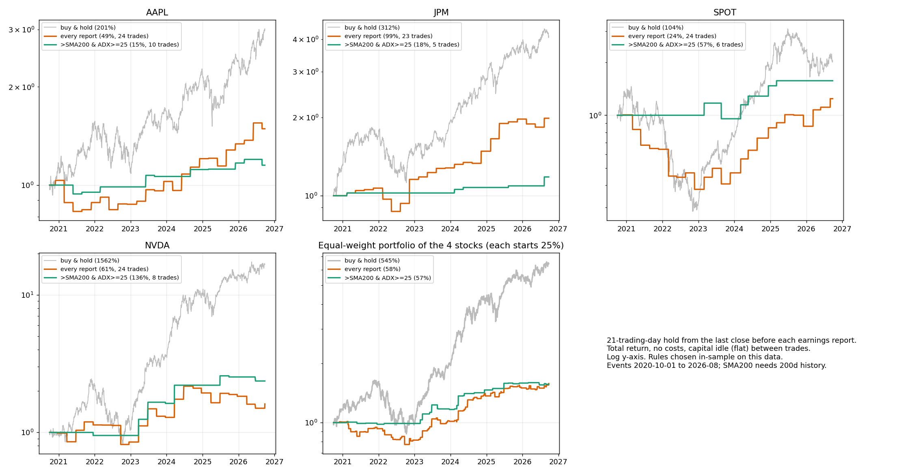

# Research

Exploratory work built on top of the finished EDGAR app: can anything in SEC
filings, insider trades, or the Fed's wording help predict how a stock moves?
None of this is part of the app. It reuses the app's rate-limited EDGAR client
(`server/src/edgar`) and nothing in `server/` or `web/` depends on it.

The full working log, including every prompt and the dead ends, is in
[`../promptlog2.md`](../promptlog2.md). This file is the map.

## Findings in one table

| Question | Answer |
|---|---|
| Does 10-K tone (Loughran-McDonald word list) predict returns? | No. 284 filings, every horizon within noise. |
| Does the Fed's statement tone or rate regime add anything? | No. |
| Does distance from the 200-day average matter? | A small positive at 6 months, but most of it is a few hindsight winners (NVDA, TSLA). |
| Does a weighted blend of tone + trend + Fed do better? | Walk-forward, the search picks "trend only" every year. |
| Do insider buys or sells predict returns? | At the 30 large companies, no. Across the whole market the buy edge is a penny-stock effect. |
| Does CEO/CFO turnover move the stock? | No reliable effect. CEO departures drop ~1pp over two days, not significant. |

Read the caveats before quoting any of it: the 30 companies were picked as
today's large caps (hindsight), Yahoo prices exclude delisted stocks
(survivorship), and samples are small. Details are in `promptlog2.md`.

## Layout

```
research/
  src/        analysis code (pure functions, no I/O except loaders)
  test/       unit tests for src/
  scripts/    runnable pipelines: download, score, analyse
    pilot/    first pass on 11 filings, superseded by the 30-company versions
```

`src/`

| file | what it does |
|---|---|
| `prices.ts` | Yahoo daily bars; return windows around a date (`windowAroundFiling`) |
| `technical.ts` | SMA and distance from it, using only data known at the time |
| `sentiment.ts` | Loughran-McDonald scoring, HTML to text, 8-K item extraction |
| `fed.ts` | FOMC statement extraction, FRED fed funds rate, rate change |
| `insider.ts` | insider-trade clustering, forward returns, data checks |
| `turnover.ts` | rule-based classifier for 8-K Item 5.02 (officer/director changes) |
| `dataset.ts` | joins filings, prices, trend and Fed data into one row per filing |
| `game.ts` | builds one game round (price window, answer) and the signals' one-line rules |
| `stats.ts` | Pearson/Spearman, p-values, OLS, leave-one-out, month-clustered mean |

## Running it

Run everything from the **repository root**: scripts read and write `.data/`
relative to it (gitignored). The SEC requires a contact in the User-Agent, set
`SEC_USER_AGENT` in `.env` as for the app.

```bash
bun test research                      # unit tests

# 1. Tone, trend and Fed (30 large companies, 10-Ks since 2016)
#    needs the Loughran-McDonald master dictionary at .data/lm/master.csv
#    (Notre Dame SRAF site; download links are on Google Drive)
bun research/scripts/tenk-corpus.ts    # download + score 10-Ks, prices for 30 tickers + SPY
bun research/scripts/fed-download.ts   # FOMC statements + fed funds rate
bun research/scripts/tone-analyze.ts   # single features, models, Fed-regime split
bun research/scripts/tone-blend.ts     # weight search, walk-forward vs baselines

# 2. Insider trades (SEC's quarterly Form 3/4/5 data sets)
bun research/scripts/insider-events.ts   # 42 quarters -> .data/insider/events.jsonl
bun research/scripts/insider-analyze.ts  # forward returns after buys / unplanned sales

# 3. Executive turnover (8-K Item 5.02)
bun research/scripts/turnover-list.ts      # find the 8-Ks
bun research/scripts/turnover-fetch.ts     # keep only the Item 5.02 text
bun research/scripts/turnover-classify.ts [flag] [n]   # classify + recall check; a flag name prints examples
bun research/scripts/turnover-analyze.ts   # returns around the events

# 4. The demo game (needs steps 1-3 to have run)
bun research/scripts/game-rounds.ts        # builds web/public/game-rounds.json
```

The download steps are slow (minutes, rate-limited to the SEC's limits) and are
resumable. The analysis steps take seconds.

## Data layout (`.data/`, not committed)

| path | contents |
|---|---|
| `corpus/scores.jsonl` | one scored 10-K per line |
| `prices/*.json` | daily OHLCV, 2014-11 onward, for the 30 tickers + SPY; SPOT from its 2018-04 listing |
| `fed/` | FOMC statement scores, fed funds target rate |
| `insider/events.jsonl` | officer/director purchases and sales, 2016-2026 |
| `turnover/` | 8-K list, Item 5.02 text, classified events |

## The demo game: Call It

`web/` has a second tab, **Call It**, in a night-mode trading-desk style. Each round
is one real past event at the 30 companies (an annual report, insider buying or
unplanned selling, or a CEO/CFO change) with the company and date hidden. The
player sees 90 days of candlesticks for the stock and for the S&P 500, plus a few
facts and calls whether the stock beats the S&P 500
over the next 21 trading days. After the call the month plays out candle by candle
in both panels with a live race meter, then the company is revealed.

Four one-line signals (trend, tone, insider, turnover) and a coin flip play the
same rounds as opponents, so a ranking of the signals comes out of play. The end
screen has a podium and shows each signal over the whole 240-round deck, which is
the honest comparison: they all sit near 50%.

Controls: `Up`/`B` beat, `Down`/`L` lag, `Space` skip the
animation, `Enter` next round. Hovering a candle shows its open/high/low/close as
percent moves. Reduced-motion users get the result instantly, without the
animation.

`scripts/game-rounds.ts` writes `web/public/game-rounds.json` (about 1.6 MB, a
static file, committed so the demo needs neither the server nor `.data/`). Rules
worth knowing:

- **Log scale, one span for both panels.** Both panels show the same number of
  percentage points per pixel (`web/src/chartScale.ts`, tested), so a +10% move is
  the same height for the stock and the index and the two can be compared by eye.
  The stock and the S&P are each rebased to 100 at their own decision-day close.
- **Nothing shown before the call leaks the answer.** Candles, the moving average
  and the facts use only data up to the decision day (`test/game.test.ts` rewrites
  the future and checks the past does not change). Insider facts use only the
  filings made that day, never the later ones the research clusters include. A
  scan of the deck finds no company name, ticker or year in any pre-call text.
- **The chart's vertical scale only includes the outcome after the call,** so the
  axis cannot hint at where the price goes, and it is fixed during the playback so
  candles are drawn into a stable frame.
- **One screen, no scrolling.** Every screen (intro, round, results) is laid out
  to fit the window: the chart measures its own box and lays the two panels out to
  fill it, so tall windows get taller candles and nothing is scaled. Short windows
  trim detail in steps (legend, opponent bars, then a two-column "field") before
  anything would need to scroll. Measured with no overflow at 1366x650, 1280x720,
  1440x800 and 1920x950. Below 980px wide the columns stack and the page scrolls.
- **The score cannot spoil a round.** Points, streak and the opponents' records only
  update once the outcome has played out.
- **Not the same definition as the research.** The game measures from the
  decision-day close over the next 21 trading days; the research scripts enter at
  the next close after the filing. Numbers will not match between the two.
- Candles were recomputed independently from the raw price files for a random
  sample of rounds (stock and S&P, before and after) and matched to the cent. The
  deck is a seeded sample (at most 6 rounds per company per kind), so rebuilding
  gives the same deck.

## Backtest: trading the earnings report with a trend filter

`results/earnings_rule_backtest.png`, run on another machine (the script is not
in this repo yet, only the chart). It asks the practical version of the tone
and trend questions: what if you actually bought around each earnings report?



Setup, as stated on the chart: for AAPL, JPM, SPOT and NVDA, buy at the last
close before each earnings report and hold **21 trading days**, then sit in cash.
Total return, no costs, October 2020 to August 2026. Three lines per stock:
buy and hold, buy at *every* report, and buy only when the stock is **above its
200-day average and ADX >= 25** (a trending market). The chart notes the rules
were chosen in-sample on this same data.

| | buy & hold | every report | above SMA200 and ADX >= 25 |
|---|---|---|---|
| AAPL | +201% | +49% (24 trades) | +15% (10) |
| JPM | +312% | +99% (23) | +18% (5) |
| SPOT | +104% | +24% (24) | +57% (6) |
| NVDA | +1562% | +61% (24) | +136% (8) |
| equal-weight portfolio | +545% | +58% | +57% |

How to read it:

- **Both rules trail buy and hold on every stock**, and by a lot in the
  portfolio (+58% and +57% against +545%). But they are not comparable on
  exposure: "every report" is invested about a third of the days (24 trades x 21
  days over ~1,500) and the filtered rule only 7-14%. Per day invested, the
  report windows do fine; they simply spend most of the time in cash while the
  market rises.
- **The trend filter did not help overall.** It lifted SPOT (+24% to +57%) and
  NVDA (+61% to +136%) and hurt AAPL (+49% to +15%) and JPM (+99% to +18%). In
  the portfolio the two rules end level (+58% vs +57%). That matches the main
  finding: distance from the 200-day average has, at best, a small and unstable
  effect on what a stock does next.
- **Fewer trades, more luck.** 5-10 trades per stock is too few to separate a
  rule from a lucky path, and the rules were picked after seeing the data, so the
  filtered line is the one to trust least.
- **The buy-and-hold portfolio is mostly one stock.** The portfolio row is the
  average of the four end values, and NVDA's 16.6x is about 64% of the total
  (3.01 + 4.12 + 2.04 + 16.62 = 25.79, /4 = 6.45x, the chart's +545%). A hindsight
  winner is doing most of the work in the comparison.

## Things worth knowing

- **Escape-sequence trap.** Several bugs came from regexes built inside string
  or template literals losing their backslashes. Use regex literals, or check the
  resulting pattern. The tests exist partly to catch this.
- **Controls depend on the universe.** The "same ticker, random dates" control
  and the "other stocks, same date" control were built for the whole market and
  give nonsense on 30 hindsight-picked names. Where a control is not valid the
  scripts still print it; the log says which columns to ignore.
- **The turnover classifier is rules, not a model.** Recall is 11/11 on events
  known to have happened; precision on CEO departures is about 75% by reading
  every flagged sentence. It is good enough to look for a large effect, not to
  count events exactly.
- **Yahoo's chart endpoint is unofficial.** It has no key but can rate-limit or
  change. Delisted tickers return 404, which the scripts treat as "unavailable".
